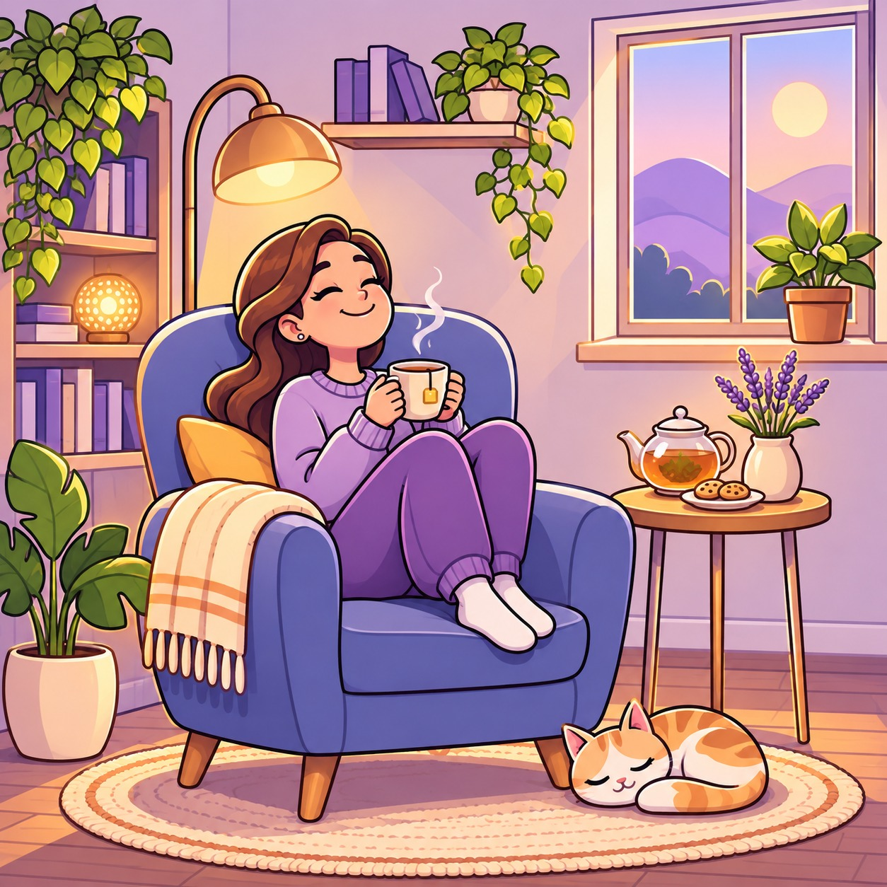

# V-02 state illustrations

These originals are square and have 480px and 960px WebP variants. Each was generated with three existing Bayit illustrations as visual references and reviewed at 375px. No screens are wired to them yet. Every item passed on its first attempt; there were no rejected attempts. The checker had no character model sheet, so character consistency was not checked by the gate.

## No household


Attempt 1: **PASS**. Visual inspection: Purple entrance, blank mat and potted plant. No visible text.

<details><summary>Gate output</summary>

```text
image      : public/illustrations/state-no-household.jpg
checked by : codex  (no reference — character check skipped)
aspect     : 1254x1254 (ratio 1.000, target 1:1 = 1.000)

  [--  ] anatomy: There are no human figures in the image. Traced: 0 arms, 0 legs, 0 hands and 0 feet.
  [OK  ] physical_logic: The plant pot and doormat rest on the floor, and the lights are attached to the building. No gross physical impossibility is apparent.
  [OK  ] text_present: No letters, numbers, words or letter-like squiggles are visible across the canvas.
  [--  ] character_consistency: No character reference was supplied.

VERDICT: PASS
```

</details>

## Offline


Attempt 1: **PASS**. Visual inspection: A disconnected plug lies beside a house. No visible text.

<details><summary>Gate output</summary>

```text
image      : public/illustrations/state-offline.jpg
checked by : codex  (no reference — character check skipped)
aspect     : 1254x1254 (ratio 1.000, target 1:1 = 1.000)

  [--  ] anatomy: There are no human figures in the image, so there are no limbs, hands or feet to trace.
  [OK  ] physical_logic: The house, tree, plants and plug have visible ground contact or support. No device is visibly reversed, and no solid object clearly passes through another.
  [OK  ] text_present: No letters, words, numbers or letter-imitating squiggles are visible across the canvas.
  [--  ] character_consistency: No reference was supplied.

VERDICT: PASS
```

</details>

## Something went wrong


Attempt 1: **PASS**. Visual inspection: Two people tend a fallen plant outside a home. No visible text.

<details><summary>Gate output</summary>

```text
image      : public/illustrations/state-error.jpg
checked by : codex  (no reference — character check skipped)
aspect     : 1254x1254 (ratio 1.000, target 1:1 = 1.000)

  [OK  ] anatomy: Man: two arms lead to two gloved hands; two legs are visible, with one shoe shown and the other foot obscured. Woman: two arms lead to two gloved hands, with the arm on the viewer’s left partly hidden by the pot; two legs are visible, with one shoe shown and the other foot obscured. The obscured portions are not defects; no extra sleeve or handless stump is visible.
  [OK  ] physical_logic: No gross physical impossibility is visible; the figures and gardening objects have plausible support.
  [OK  ] text_present: No letters, words, numbers, or letter-imitating squiggles found across the canvas.
  [--  ] character_consistency: No character reference was supplied.

VERDICT: PASS
```

</details>

## Invite sent


Attempt 1: **PASS**. Visual inspection: A blank sealed envelope travels toward a house. No visible text.

<details><summary>Gate output</summary>

```text
image      : public/illustrations/state-invite-sent.jpg
checked by : codex  (no reference — character check skipped)
aspect     : 1254x1254 (ratio 1.000, target 1:1 = 1.000)

  [--  ] anatomy: No human figures are present. Traced totals: 0 arms, 0 hands, 0 legs and 0 feet.
  [OK  ] physical_logic: No gross physical impossibility was found. The airborne envelope is part of the visibly magical scene.
  [OK  ] text_present: No letters, words, numbers or letter-like squiggles were found across the canvas.
  [--  ] character_consistency: No character reference was supplied.

VERDICT: PASS
```

</details>

## Week done


Attempt 1: **PASS**. Visual inspection: Two people rest on a sofa beside a trophy and flowers. No visible text.

<details><summary>Gate output</summary>

```text
image      : public/illustrations/state-week-done.jpg
checked by : codex  (no reference — character check skipped)
aspect     : 1254x1254 (ratio 1.000, target 1:1 = 1.000)

  [OK  ] anatomy: Man: two arms traced, one to the hand holding the blue mug and one partly hidden behind the woman to the hand on her shoulder; two legs extend from his hips and their lower ends are hidden by foreground objects. Woman: two arms traced to the hands holding the pink mug, and two legs traced to socked feet; no extra sleeve or handless stump is visible.
  [OK  ] physical_logic: No gross physical impossibility is visible.
  [OK  ] text_present: No letters, numbers, words, or letter-like squiggles found across the canvas.
  [--  ] character_consistency: No reference was supplied.

VERDICT: PASS
```

</details>

## Day done, morning


Attempt 1: **PASS**. Visual inspection: Two people celebrate at a sunny breakfast table. No visible text.

<details><summary>Gate output</summary>

```text
image      : public/illustrations/state-morning-done.jpg
checked by : codex  (no reference — character check skipped)
aspect     : 1254x1254 (ratio 1.000, target 1:1 = 1.000)

  [OK  ] anatomy: Man: two arms, one ending in a raised hand and one in a fist; two legs ending in shoes. Woman: two arms, one ending in a raised hand and one in a fist; two legs ending in shoes. Parts of both figures’ hips and legs are legitimately hidden by the table; no extra sleeve or handless stump is visible.
  [OK  ] physical_logic: No gross physical impossibility is apparent. The seated figures and furniture have visible support.
  [OK  ] text_present: No letters, numbers, words, or letter-like squiggles found across the canvas.
  [--  ] character_consistency: No reference was supplied.

VERDICT: PASS
```

</details>

## Day done, evening


Attempt 1: **PASS**. Visual inspection: Two people celebrate in a moonlit living room. No visible text.

<details><summary>Gate output</summary>

```text
image      : public/illustrations/state-evening-done.jpg
checked by : codex  (no reference — character check skipped)
aspect     : 1254x1254 (ratio 1.000, target 1:1 = 1.000)

  [OK  ] anatomy: Man: one arm traces from his viewer-left shoulder to a raised fist; his other shoulder and arm disappear behind the woman, a legitimate occlusion. Two legs end in two shoes. Woman: two arms trace from her shoulders to two fists, and two crossed legs end in two shoes, with parts of the legs hidden by the crossing; no extra sleeve or stump is visible.
  [OK  ] physical_logic: The people and objects have plausible support; the airborne stars, medals and confetti read as decorative symbols.
  [OK  ] text_present: No letters, numbers, words or letter-like squiggles found across the canvas.
  [--  ] character_consistency: No reference was supplied.

VERDICT: PASS
```

</details>

## Busy-day calm



Attempt 1: **PASS**. Visual inspection: A woman rests with tea beside a sleeping cat. No visible text.

<details><summary>Gate output</summary>

```text
image      : public/illustrations/state-busy-day.jpg
checked by : codex  (no reference — character check skipped)
aspect     : 1254x1254 (ratio 1.000, target 1:1 = 1.000)

  [OK  ] anatomy: One human figure: two arms traced from the shoulders to the hands holding the cup; the viewer-right arm is partly hidden by the cup and raised leg. Two bent legs lead to two sock-covered feet; parts of their attachment at the hips are hidden by the seated pose. No extra sleeve or handless stump is visible, and the partially obscured fingers cannot all be counted reliably.
  [OK  ] physical_logic: The chair, table and plant pots have visible support or ground contact; no grossly impossible object placement is apparent.
  [OK  ] text_present: No letters, numbers, words or letter-like squiggles are visible across the canvas.
  [--  ] character_consistency: No character reference was supplied.

VERDICT: PASS
```

</details>

## Shopping list done


Attempt 1: **PASS**. Visual inspection: A grocery bag filled with vegetables sits on a counter. No visible text.

<details><summary>Gate output</summary>

```text
image      : public/illustrations/state-shopping-done.jpg
checked by : codex  (no reference — character check skipped)
aspect     : 1254x1254 (ratio 1.000, target 1:1 = 1.000)

  [--  ] anatomy: No human figures are present. There are no limbs, hands, or feet to trace.
  [OK  ] physical_logic: The bag, bowls, pots, and utensils appear supported. No gross physical impossibility is visible.
  [OK  ] text_present: No letters, numbers, words, or letter-like squiggles are visible across the canvas.
  [--  ] character_consistency: No character reference was supplied.

VERDICT: PASS
```

</details>

## Meals plan empty


Attempt 1: **PASS**. Visual inspection: An empty plate rests on a kitchen table. No visible text.

<details><summary>Gate output</summary>

```text
image      : public/illustrations/state-meals-empty.jpg
checked by : codex  (no reference — character check skipped)
aspect     : 1254x1254 (ratio 1.000, target 1:1 = 1.000)

  [--  ] anatomy: There are no human figures in the image, so no limbs, hands, or feet could be traced.
  [OK  ] physical_logic: No gross physical impossibility is apparent. Furniture and objects are supported or have their supports hidden by the composition.
  [OK  ] text_present: No letters, numbers, words, or letter-like squiggles are visible on the canvas.
  [--  ] character_consistency: No character reference was supplied.

VERDICT: PASS
```

</details>

## Playlist finished


Attempt 1: **PASS**. Visual inspection: Headphones and musical notes sit in a tidy room. No visible text.

<details><summary>Gate output</summary>

```text
image      : public/illustrations/state-playlist-done.jpg
checked by : codex  (no reference — character check skipped)
aspect     : 1254x1254 (ratio 1.000, target 1:1 = 1.000)

  [OK  ] anatomy: There are no human figures in the image, so there are no limbs, hands, or feet to trace.
  [OK  ] physical_logic: The furniture and objects appear supported. No gross physical impossibility is visible.
  [OK  ] text_present: No letters, words, numbers, or letter-like squiggles are visible. The floating musical notes are pictorial symbols.
  [--  ] character_consistency: No reference was supplied.

VERDICT: PASS
```

</details>

## First task done


Attempt 1: **PASS**. Visual inspection: Folded towels rest on a shelf. No visible text.

<details><summary>Gate output</summary>

```text
image      : public/illustrations/state-first-task-done.jpg
checked by : codex  (no reference — character check skipped)
aspect     : 1254x1254 (ratio 1.000, target 1:1 = 1.000)

  [--  ] anatomy: No human figures are present; zero arms, legs, hands, or feet to trace.
  [OK  ] physical_logic: The plant, towels, and diffuser rest on a shelf supported by two wall brackets. No gross physical impossibility is apparent.
  [OK  ] text_present: No letters, numbers, words, or letter-like squiggles are visible across the canvas.
  [--  ] character_consistency: No reference was supplied.

VERDICT: PASS
```

</details>

## Page not found


Attempt 1: **PASS**. Visual inspection: A garden path reaches a closed gate. No visible text.

<details><summary>Gate output</summary>

```text
image      : public/illustrations/state-not-found.jpg
checked by : codex  (no reference — character check skipped)
aspect     : 1254x1254 (ratio 1.000, target 1:1 = 1.000)

  [--  ] anatomy: There are no human figures in the image. Figures traced: 0; limbs traced: 0.
  [OK  ] physical_logic: No gross physical impossibility is apparent. The gate, pillars, lanterns and house appear supported.
  [OK  ] text_present: No letters, numbers, words or letter-like squiggles found across the canvas.
  [--  ] character_consistency: No reference was supplied.

VERDICT: PASS
```

</details>
